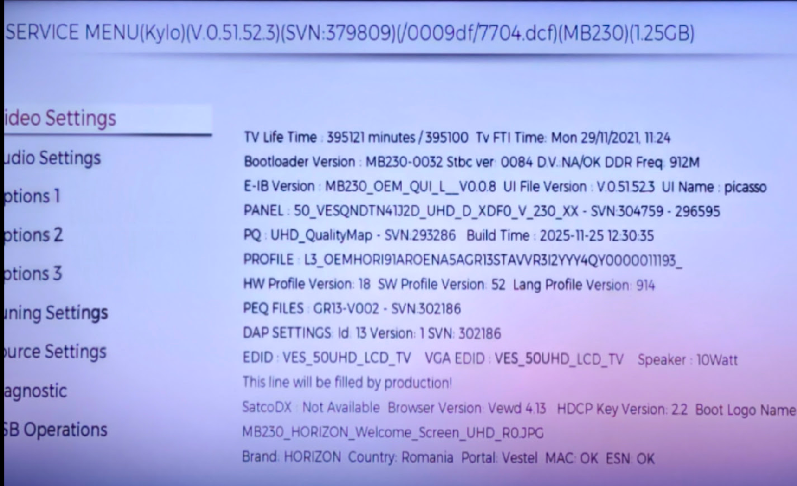
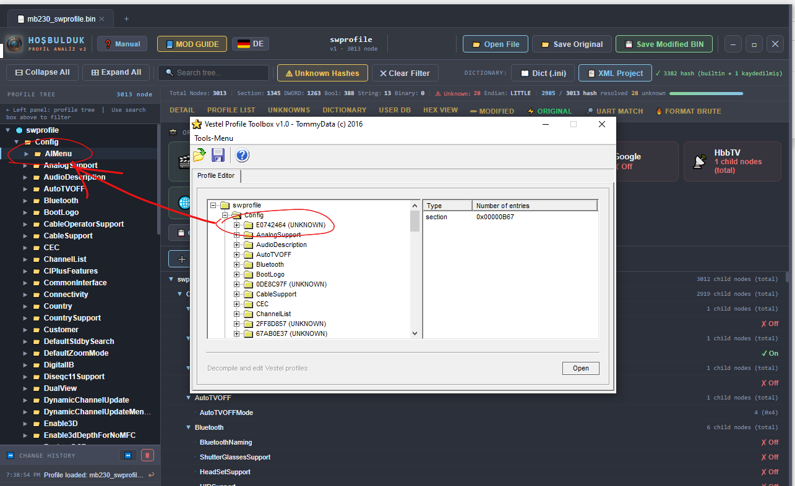
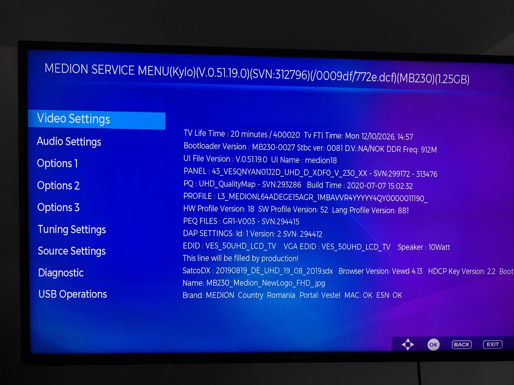

# Horizon (Vestel) MB230 - another rebranded device.

Why would I bother when there is no new updates, the Apps crashes randomly, unexpected restarts... useless effort spent, right?




## What I'd like to get
- Debloating, if possible
- Root terminal and/or SSH
- Porting custom apps
- OS performance/optimization

My TV has passed the TV's hours lifetime, I have not received any update for the past 12 months. Netflix and Youtube apps (which I use the most) are constantly crashing and the OS either is unresponsive 'til the app *magically* recovers, it reboots after >30seconds or I have to manually unplug it. 
Not to mention the HDMI ports sometimes works sometimes doesn't.

## What you'll get 
- [mb230-inspector](mb230_inspector.py). A Python app to help you analyze the dump files extracted from your MB230 TV. **Remember, might not work and/or contain bugs**
- [RESEARCH.MD](RESEARCH.MD) A full overview with the finding during my investigation (hint: 🔑 gold mine )
- [ARCHITECTURE.MD](ARCHITECTURE.md) A detailed architecture spec based on my own analysis. Kudos to https://clixad.io/ for FREE LLM usage. 
- [hello-world/](hello-world/) — minimal custom app proof (ARM binary + source + Docker build script) that can be uploaded and run directly via telnet once you have a root shell. Includes the first prebuilt `hello` binary.
- [gui-hello-world/](gui-hello-world/) — second test: framebuffer GUI "Hello World" app with on-screen button/status feedback for remote/input events (Docker-built static ARM binary, uploadable via telnet).
- 🚀 Downgrading info, see bellow!
- 🔓 **Jailbreak / root shell via USB injection — see [mb230-usb-jailbreak](https://github.com/nirodg/mb230-usb-jailbreak)** (live proof: stock TV fully working + `telnet` root)

## Tools
- [Vestel Profile Toolbox (TommyData)](https://www.bekozap.com/hacking-the-software-of-vestel-tv-7/) - tested and working, some hex values are not displayed, is an old app and my TV was released on 2019. I bet if I do some digging I could update the dictionary.ini to display new values.
- [Hosbulduk-Profil-Analiz](https://github.com/Hosbulduk/Hosbulduk-Profil-Analiz/) - not tested, contains NEW HEX values, seems promissing!
- **Dropbear SSH (MB230 port)** — static ARMv7 Dropbear server/client tools with
  an on-TV installer (host keys in `/conf/dropbear`, root access helper, telnet
  untouched): [`usb-injection/tools/dropbear/`](usb-injection/tools/dropbear/README.md).

*Showcasing OLD vs NEW tool*


## Breakthrow - Downgrade!


Running Medion's FW on a Horizon TV - what a day! 



I have managed to get my hands on a Full Update for Medion MD 30010 that (nearly) fully works. 

I can honestly say is worth it, the TV moves way faster compared with the previous Horizon fw's version. 

**Remarks**: the TV Life Time gets reset to **0 minutes**. This means, if you get the FULL Update for your specific TV you could "get back" your TV's warranty. Disclaimer, keep in mind when you purchased the TV. I bet if the Life time passed the limit displayed in the Service Menu the Technician might not apply warranty even if is still legally "under warranty"

### What works
- Downgrading from V0.51.52.3 to v0.51.19.0
- Image and Sound works
- WIFI
- Digital channels
- Encrypted channels with the Smart CAM Card
- Portal (apps)
- Any available OS language (i18n)
- HDMI ports are working now!

### Doesn't work
- Remote controll mapping: Youtube Button
- Less Portal apps, only includes the German version (as it comes with the German FW)
- It enabled a 4th HDMI port the TV doesn't have and it some "crashes"/overlaps with the Plex APP.
- with Enhanced HDMI and my MiBox4 I sometimes loose video input (same with the original FW)

### TODOs

- Using the Vestel Toolbok (the I should dump the new fwprofile and restore some values from my original FW.
- I could compare new and old fwprofile and see what values changed. Pissibly changing the App Store do a diff. vendor.
- Anything you could thing it be of use please create a ticket.

#### How to get the SW 
Doing a quick Google search for "Medion MD 30010 FULL UPDATE EN" you'll find a zip file with 218.2 MB

##### Applying the (down)grade
- Copy to a FAT32 USB Drive `kylo_usb_update.bin` and `kylo_usb_update.scr` 
- Unplug the TV
- While plugging the TV press `OK` on the remote controller
- You'll see the SW how it get's installed
- Give it some time and you'll see a nice "Welcome" screen.
- Do the setup as usual. 

## 🔓 Jailbreak — root shell over USB injection (stock TV keeps working)

**Status: achieved and verified on-device (Nov 2026).** The full step-by-step, reusable tooling and disclaimer live in the dedicated repo: **[mb230-usb-jailbreak](https://github.com/nirodg/mb230-usb-jailbreak)** (this repository is included there as a git submodule for the research docs).

```
/mtd_apexe/board # id
uid=0(root) gid=0(root)
/mtd_apexe/board # uname -a
Linux (none) 4.9.118+ #2 SMP PREEMPT Wed Apr 1 14:12:52 CST 2020 armv7l GNU/Linux
```

TL;DR of how it works (all details + evidence in [`stage1/uboot/README.md`](stage1/uboot/README.md) and [`usb-injection/`](usb-injection/)):
1. The service-menu USB update channel runs **unsigned U-Boot scripts** (`kylo_usb_update.scr`) from a FAT32 stick (hold **OK** at power-on) — this is a genuine vendor feature, and scripts can read/write UBI volumes with CRC verification.
2. That channel is used to write two *userspace* volumes: the **ap0** root (adds a tiny shim that gets launched instead of `idtv`, then `exec`s the real `aurora.elf`) and the **conf** volume (our `opentv_payload` wrapper).
3. The wrapper **restores the full stock environment** that the shim's `exec` drops (`BROWSER_DIR`, `WORKING_PATH`, ~80 exports from `run.sh`), mounts **`/dev/pts`**, starts `telnetd` on :23 (+ an `nc` fallback on :2323), and finally `exec`s the stock `aurora.elf` as `idtv`.
4. Result: **aurora (the whole TV experience) runs normally** — tuner, menu, apps, watchdog all satisfied — while a background keeper keeps a persistent root shell alive.

Key debugging insights (see the repo history for the full 3.6→3.12 saga):
- `FATAL:base_paths_tvsdk.cc(72) browser_dir ... does not exist` + `The $HOME environment variable is not set` → aurora was running with an **empty environment** (SIGABRT → watchdog reboot ~every 20-25s, masquerading as a white screen/square).
- busybox `telnetd` accepts TCP connections but resets them if **`/dev/pts` is not mounted** (stock init never mounts devpts).

Bonus: with root, the TV exposes more usable pieces than expected — busybox `fbsplash` (direct framebuffer draw on `/dev/fb0..2`), a standalone **Cobalt** browser that accepts `--url=file://...` (arbitrary local HTML dialogs/apps, `--remote_debugging_port=9222` for DevTools), and a full **GStreamer** install (`gst-launch-1.0`, `nvt-mmplayer`).

## How to get in touch? 

Open a ticket in the Issues sections, I might keep working on (un)paking the Medion SW that works on my TV, the aim? Custom Apps and debloating as much as possible for the TV to get its best (remaing) life time.

## Disclaimer
All the information was freely accessible via Internet (Search Engines), some LLM help and a couple of hours spent on it, ~10 hours.

## Warranty
THIS GIT REPOSITORY AND IT'S CONTENT IS PROVIDED "AS IS", WITHOUT WARRANTY OF ANY KIND, EXPRESS OR IMPLIED, INCLUDING BUT NOT LIMITED TO THE WARRANTIES OF MERCHANTABILITY, FITNESS FOR A PARTICULAR PURPOSE AND NON-INFRINGEMENT.

## Appreciations
Thanks to [DeepSeek](https://github.com/deepseek-ai) for being one of the known free-to-use LLMs that helped me during this reverse engineering's research. Such a pitty I have reached the limitation for the context window on the chat. 

## Useful links
- https://www.scribd.com/document/992536354/Mainboard-17MB230-PDF
- https://www.elektroda.com/qa,50hl7590-vestel-17mb170-firmware-panel-emmc.html
- https://www.manualslib.com/manual/3391806/Vestel-Mb230-Idtv.html?page=35
- https://www.elforum.info/topic/136160-profile-vestel-lcd-de-reparare-17mbxx/#comments

I've tried creating accounts in some of the links above but either "new accounts" are disabled nor willing to pay any premium fee.

If you found this helpful consider buying me a coffee ☕
 
