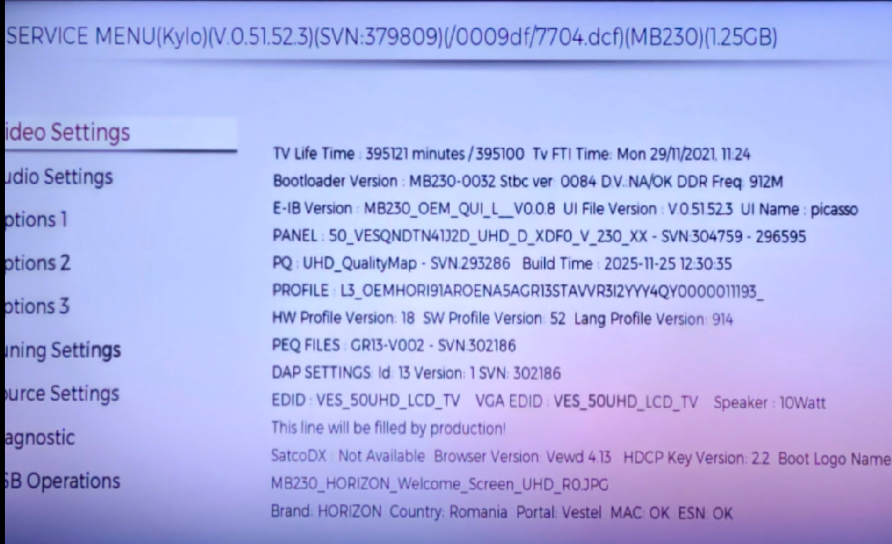
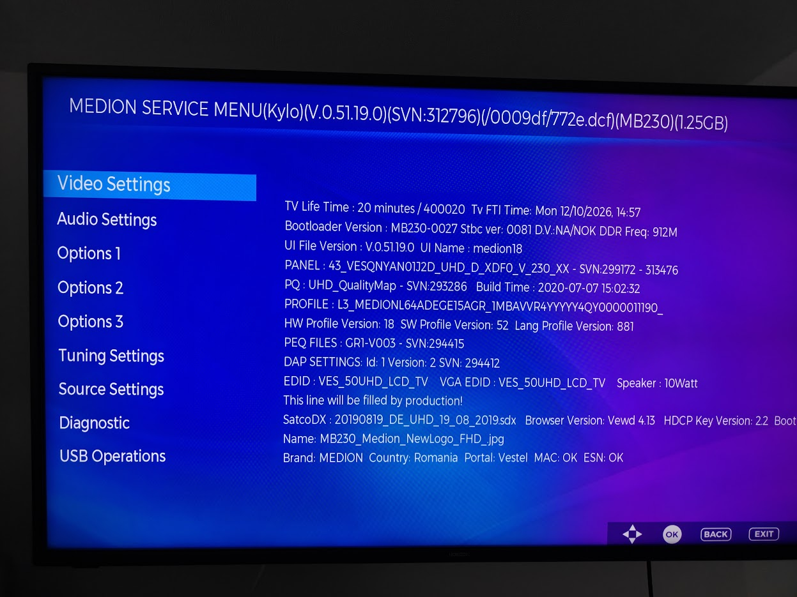

# Horizon (Vestel) MB230 - another rebranded device.

Why would I bother when there is no new updates, the Apps crashes randomly, unexpected restarts... useless effort spent, right?

## What I'd like to get
- Debloating, if possible
- Root terminal and/or SSH
- Porting custom apps
- OS performance/optimization

My TV has passed the TV's hours lifetime, I have not received any update for the past 12 months. Netflix and Youtube apps (which I use the most) are constantly crashing and the OS either is unresponsive 'til the app *magically* recovers, it reboots after >30seconds or I have to manually unplug it. 
Not to mention the HDMI ports sometimes works sometimes doesn't.

## What you'll get 
- [mb230-inspector](mb230-inspector/). A Python app to help you analyze the dump files extracted from your MB230 TV. **Remember, might now work  and/or contain bugs**
- [RESEARCH.MD](RESEARCH.MD) A full overview with the finding during my investigation (hint: 🔑 gold mine )

## Breakthrow - Downgrade!

Running Medion's FW on a Horizon TV - what a day! 

I have managed to get my hands on a Full Update for Medion MD 30010 that (nearly) fully works. 

I can honestly say is worth it, the TV moves way faster compared with the previous Horizon fw's version. 

**Remarks**: the TV Life Time gets reset to **0 minutes**. This means, if you get the FULL Update for your specific TV you could "get back" your TV's warranty. Disclaimer, keep in mind when you purchased the TV. I bet if the Life time passed the limit displayed in the Service Menu the Technician might not apply warranty even if is still legally "under warranty"

### What works
- Downgrading from V0.51.52.3 to v0.51.19.0
- Image and Sound works
- WIFI
- Digital channels
- Encrypted channels with the Smart CAM Card
- Portal (apps)
- Any available OS language (i18n)

### Doesn't work
- Remote controll mapping: Youtube Button
- Less Portal apps, only includes the German version (as it comes with the German FW)

#### How to get the SW 
Doing a quick Google search for "Medion MD 30010 FULL UPDATE EN" you'll find a zip file with 218.2 MB

##### Applying the (down)grade
- Copy to a FAT32 USB Drive `kylo_usb_update.bin` and `kylo_usb_update.scr` 
- Unplug the TV
- While plugging the TV press `OK` on the remote controller
- You'll see the SW how it get's installed
- Give it some time and you'll see a nice "Welcome" screen.
- Do the setup as usual. 

## How to get in touch? 

Open a ticket in the Issues sections, I might keep working on (un)paking the Medion SW that works on my TV, the aim? Custom Apps and debloating as much as possible for the TV to get its best (remaing) life time.

## Warranty
THE SOFTWARE IS PROVIDED "AS IS", WITHOUT WARRANTY OF ANY KIND, EXPRESS OR IMPLIED, INCLUDING BUT NOT LIMITED TO THE WARRANTIES OF MERCHANTABILITY, FITNESS FOR A PARTICULAR PURPOSE AND NONINFRINGEMENT.

## Appreciations
Thanks to DeepSeek for being one of the known free-to-use LLMs that helped me during this reverse engineering's research.

If you found this helpful consider buying me a coffee ☕
 
